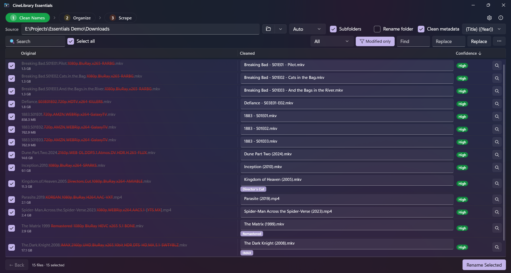
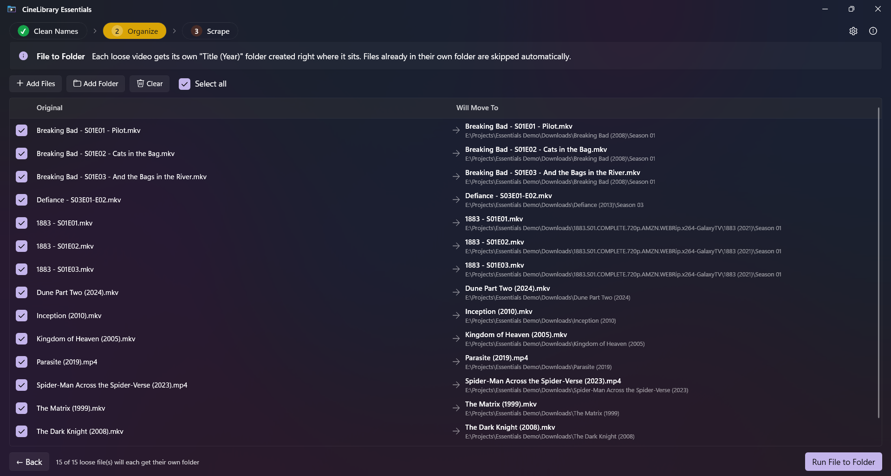
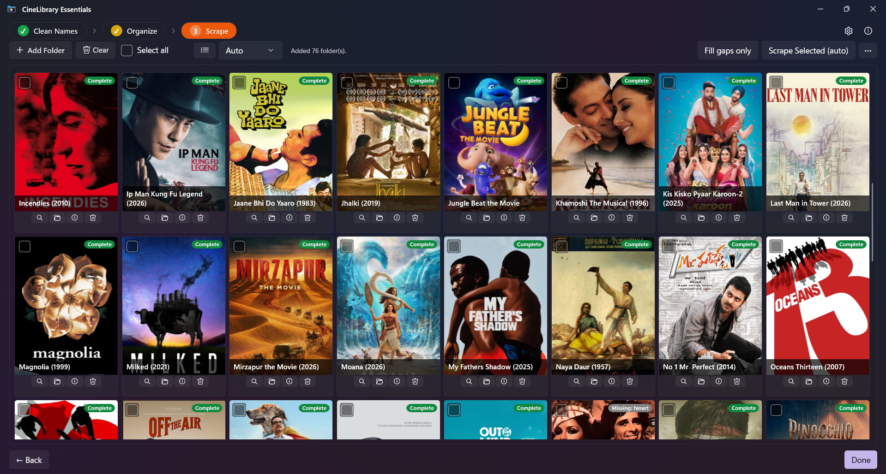
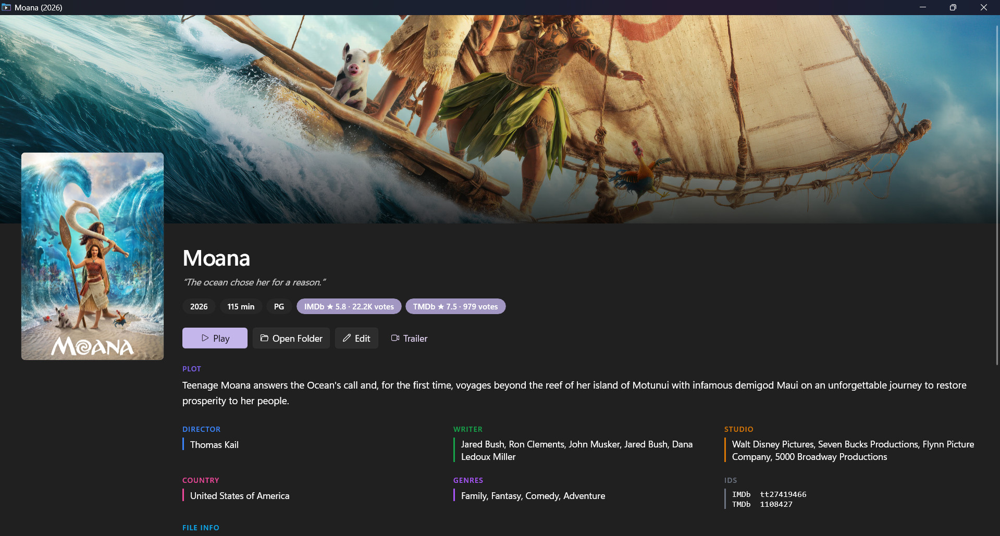
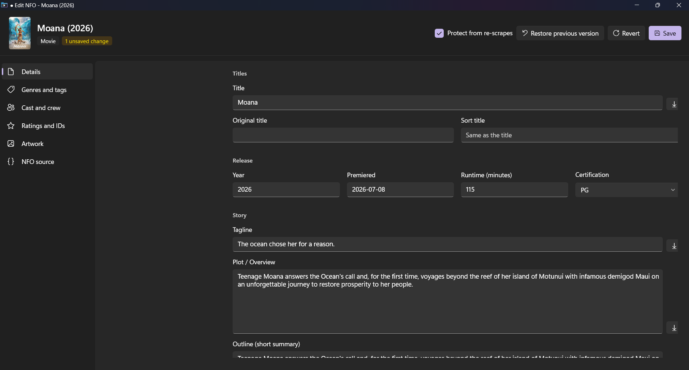
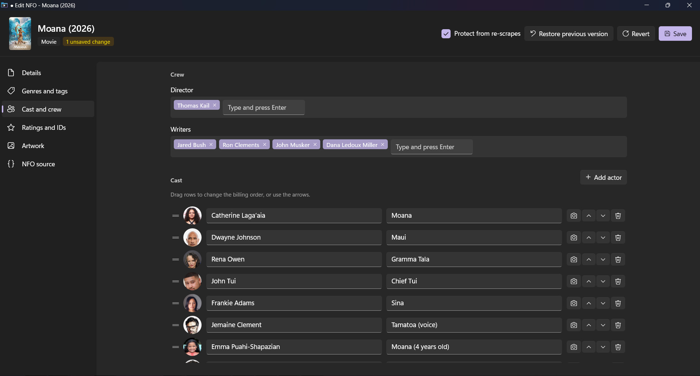
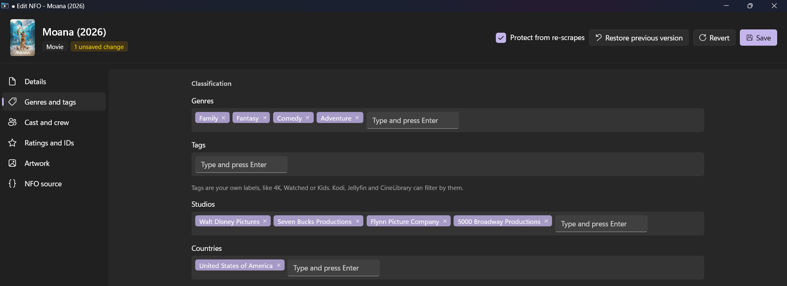
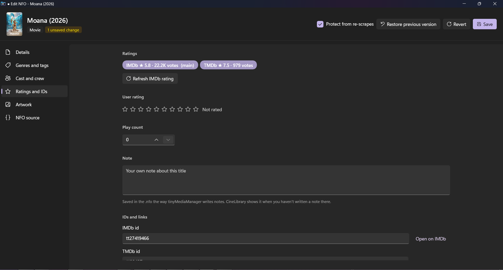
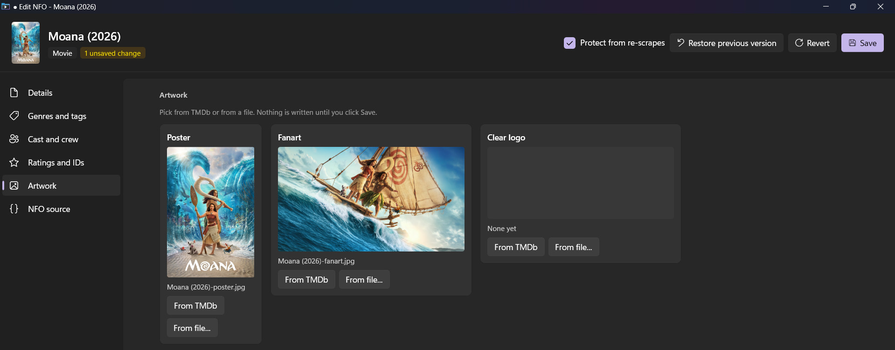

<div align="center">
  
  <h1>CineLibrary Essentials</h1>
  <p>
    <b>Drag your movie folder in and let the magic begin!</b><br/>
    Clean up messy movie downloads - rename, organize, and scrape, all in one app.
  </p>
  <p>
    A Windows desktop tool (WinUI 3) that takes the chaos out of your downloads folder.
    Recommended as the preparation step for
    <a href="https://github.com/aungkokomm/CineLibraryCS">CineLibrary</a>.
  </p>
</div>


---


## What it does

Most downloads come with messy filenames like:

```
UnTouch.The.Kerala.Story.2.2026.1080p.WEB-HDRip.Hindi.DDP5.1.MULTi.x264.ESub-india4Movies.Diy.mkv
Breaking.Bad.S01E03.And.the.Bags.in.the.River.1080p.BluRay.x265-RARBG.mkv
```

CineLibrary Essentials cleans them, organizes them into the right folder structure, and scrapes full metadata - for **both movies and TV shows**:

**Movies** → `Title (Year)/`

```
Movies/
├── The Kerala Story 2 (2026)/
│   ├── The Kerala Story 2 (2026).mkv
│   ├── The Kerala Story 2 (2026)-poster.jpg
│   ├── The Kerala Story 2 (2026)-fanart.jpg
│   ├── The Kerala Story 2 (2026).nfo
│   └── .actors/
└── Bawarchi (1972)/
    └── ...
```

**TV shows** → `Show (Year)/Season XX/`

```
TV/
└── Breaking Bad (2008)/
    ├── tvshow.nfo
    ├── poster.jpg
    ├── fanart.jpg
    ├── .actors/
    └── Season 01/
        ├── Breaking Bad - S01E01.mkv
        ├── Breaking Bad - S01E01.nfo
        ├── Breaking Bad - S01E01-thumb.jpg
        └── ...
```

The real episode title (e.g. "Pilot") comes from TMDb and is written into each episode's `.nfo`, which Kodi, Plex, Jellyfin and CineLibrary display. It stays in the filename only if the original filename already had it, unless you turn on **Settings → Add episode titles to file names**, which gives you `Breaking Bad - S01E01 - Pilot.mkv` (with an Undo).

This is the **Plex / Kodi / Jellyfin / MediaElch** standard layout - readable by every major media player and library manager.

---
<p align="center">
  <br/>
  <em><b>Step 1 · Clean Names</b> - messy filenames cleaned in place. A red strikethrough shows what was removed, editions like Director's Cut and IMAX get a chip, and a double episode keeps both numbers.</em>
</p>

<p align="center">
  <br/>
  <em><b>Step 2 · Organize</b> - each movie gets its own <code>Title (Year)</code> folder and each episode goes into <code>Show (Year)\Season XX</code>, with a "Will Move To" preview before you run it.</em>
</p>

<p align="center">
  <br/>
  <em><b>Step 3 · Scrape</b> - posters, fanart, cast photos and a full Kodi NFO for every folder. Each card shows its whole poster and whether anything is missing.</em>
</p>

<p align="center">
  <br/>
  <em><b>Details</b> - double-click a scraped card for its fanart, both ratings, the plot, the crew and the cast.</em>
</p>

<p align="center">
  <br/>
  <em><b>Edit NFO</b> - right-click a card to edit every field of its .nfo. Only what you change is written, and every save can be restored.</em>
</p>

<p align="center">
  <br/>
  <em><b>Cast and crew</b> - drag actors to change the billing order, change a photo, or add someone TMDb missed.</em>
</p>

<details>
<summary><b>More of the editor (click to expand)</b></summary>

<p align="center">
  <br/>
  <em><b>Genres and tags</b> - genres, tags, studios and countries as chips, with suggestions from your library.</em>
</p>

<p align="center">
  <br/>
  <em><b>Ratings and IDs</b> - both ratings, your own rating, a play count and a note of your own.</em>
</p>

<p align="center">
  <br/>
  <em><b>Artwork</b> - pick a poster, fanart or clear logo from everything TMDb has, or from a file.</em>
</p>

</details>

## Workflow

```
┌────────────────────────────────┐    ┌──────────────────────────┐
│     CineLibrary Essentials     │ →  │  CineLibrary (browse it) │
│  Rename · Organize · Scrape    │    │   Scan + add to library  │
└────────────────────────────────┘    └──────────────────────────┘
```

CineLibrary Essentials is now an **all-in-one** preparation toolbox 
 -  clean filenames, organize into the correct folder structure, and scrape a complete Kodi-standard NFO with poster, fanart, full cast photos, and (for TV) per-episode metadata + thumbnails. One-Stop-Solution.

- **[CineLibrary](https://github.com/aungkokomm/CineLibraryCS)** - scan the prepared library and browse it across multiple drives.
- **[MediaElch](https://www.mediaelch.de/)** - still optional if you want to layer in extra sources or edition-specific artwork; it reads the same folders Essentials produces.

---

## User Guide

📖 **User guide:** [`docs/USER_GUIDE.md`](docs/USER_GUIDE.md) - covers every feature, edge case, and troubleshooting tip.

📖 **Full detailed user guide** [In my GitHub.io **CineLibrary Essentials page**] (https://aungkokomm.github.io/cinelibraryessentials/guide/)

Short version below - the app is a **3-step wizard**. The header pills (`① Clean Names → ② Organize → ③ Scrape`) show where you are.

A **Mode** selector (Auto · Movies · TV Shows) lets you tell the app what you're processing. **Auto** detects each file; **Movies** / **TV Shows** force one type. A **⚙ Settings** dialog (gear icon, top-right) holds your output template, scrape language, default toggles, and update preferences.

### Step 1 · Clean Names

Pick a folder (or **drag-and-drop** one onto the window).

- **Auto-detect** - extracts title + year for movies, or show + season + episode for TV, and strips technical tags (`1080p`, `x265`, `BluRay`, `WEB-HDRip`, `Atmos`, release-group prefixes, etc.)
- **TV episodes** → `Show - S01E01` (plus the episode title if the original filename has one, and both numbers for a double episode: `S03E01-E02`); **Movies** → `Title (Year)`
- **Edition detection** - Director's Cut, Extended, IMAX, 4K Remaster, Theatrical, Unrated, Criterion … shown as a chip and written to the NFO
- **Diff highlight** - original filename shows kept tokens in grey, removed tokens in **red strikethrough**
- **Confidence chip**, editable rows, bulk Find & Replace / Title Case / Reset, search + filters
- **Per-row 🔍 Scrape** - search TMDb (movies or TV) to confirm the exact match
- Subtitles (incl. language-tagged like `.en.forced.srt`) follow the rename automatically
- **Words to always remove** - teach it the tags it doesn't know (a release group's name, a site watermark) once in Settings
- **Show only warnings** - one click next to the file count shows just the rows with a ⚠, and one click goes back
- **Keyboard** - `Ctrl+A` selects or clears all, `F2` edits the focused row's new name, `Enter` finishes, `Delete` removes the row from the list (the file is untouched)
- Picked a `Season 01` folder? It offers to load the whole show folder instead, so Steps 2 and 3 see every season

### Step 2 · Organize

Files carry over from Step 1, or add a folder directly. Each loose file gets its own folder, created right where the file already is. Files that are already in their own folder are skipped.

- **Movies** → `Title (Year)/Title (Year).ext`
- **TV** → `Show (Year)/Season XX/Show - S01E01.ext` (the year comes from TMDb)
- **Subs folders** - a `Subs` folder moves along with its movie
- **Folder merging** - if a destination already exists, files merge in instead of erroring (nothing overwritten)
- Click **Run File to Folder** - moves everything (subtitles included), then auto-advances to Step 3

### Step 3 · Scrape

Folders from Step 2 are auto-listed. You can also **+ Add Folder** for any existing library folder.

- **Movies** → downloads `Title (Year).nfo`, original-resolution poster + fanart, and a `.actors/` folder with the full cast's photos
- **Your choice of what's written** - in Settings, limit the cast (10 to 50), keep only the first studio, director and writer, and pick smaller picture sizes
- **TV shows** → downloads `tvshow.nfo` + show poster/fanart/cast into the show folder, then a per-episode `.nfo` (with the real episode title) + episode thumbnail for every episode
- **IMDb + TMDb ratings** - every NFO gets both, with vote counts. Pick which one players show first in Settings, and update them any time with **⋯ → Refresh IMDb ratings** (only the ratings change, nothing is re-scraped)
- **Double-tap a scraped card** (or its ⓘ button) → a rich **Movie Details** window (hero fanart, poster, plot, both ratings, color-coded crew/studio/country/genres/IDs/file-info, scrollable cast)
- **TV shows** - cards read `TV · 3 seasons · 24 episodes`, and the details window lists every episode with its thumbnail and air date, plus the aired episodes you're **missing**
- **Edit NFO** - right-click a card for a full, resizable editor: every detail field, genres and tags as chips with suggestions from your library, a cast editor, TV episodes, fetch any field from TMDb in another language, and artwork picked from everything TMDb has (poster, fanart, clear logo, landscape). Only what you change is written, every save can be restored, and your edits are protected from Fill gaps and Scrape Selected
- **Bulk edit** - set a collection, certification, genres, tags or protection for all checked cards at once
- **Scrape Selected (auto)** - batch-scrape everything checked, with a progress bar
- **Fill gaps only** - *Verify-library* sweep: scrapes only folders missing the NFO, poster, fanart, or actor photos; skips complete ones
- **16 languages** - set the scrape language in Settings (English, Burmese, Hindi, Tamil, Telugu, Thai, Chinese, Japanese, Korean, and more)

---


## Install

Download the latest installer from [Releases](../../releases) and run:

- `CineLibraryEssentials_Setup_<version>.exe` (~63 MB, self-contained - no prerequisites)
- Per-user install, no admin required
- Optional desktop / Start Menu shortcut

**Minimum:** Windows 10 build 17763 (1809) or newer · x64

Once installed, the app **checks for updates on startup** (once per day) and offers to download + install new versions for you - no need to come back here.

**Found a bug?** Open **ⓘ About → Copy diagnostics** and paste it into a [GitHub issue](../../issues). It holds the app version, your settings (never your API key) and this session's warnings; have a look before you post it.

---

## Build from Source

Requires **.NET 10 SDK**, **Windows App SDK**, and **Inno Setup 6+** (for the installer).

```powershell
# Run + debug
dotnet build -p:Platform=x64 -p:RuntimeIdentifier=win-x64

# Build the installer (publishes self-contained Release + runs Inno Setup)
.\build-installer.ps1

# Unit tests (filename parser, NFO ratings + editor, TV episode checks)
dotnet test tests\CineLibraryEssentials.Tests
```

Output: `release\CineLibraryEssentials_Setup_<version>.exe`

---

## Tech

- **WinUI 3** (Windows App SDK 2.0)
- **.NET 10**
- **CommunityToolkit.Mvvm** for MVVM
- **TMDb API** for metadata (key embedded - get your own at [themoviedb.org](https://www.themoviedb.org/settings/api) if you want to swap it)

---

## Credits

- Built by [@aungkokomm](https://github.com/aungkokomm)
- Movie metadata by [TMDb](https://www.themoviedb.org/) (this product is not endorsed or certified by TMDb)
- IMDb ratings: information courtesy of [IMDb](https://www.imdb.com), used with permission, fetched through the free Agregarr ratings service
- Companion to [CineLibrary](https://github.com/aungkokomm/CineLibraryCS)

---

<p align="center"><sub>MIT licensed · © 2026 Aung Ko Ko · <a href="https://aungkokomm.github.io/">more of my apps</a></sub></p>
